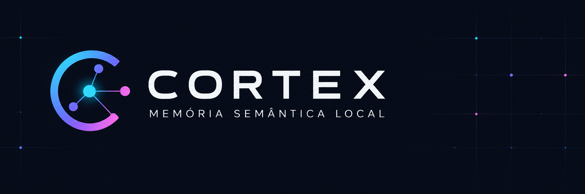

<p align="center">
  
</p>

> Long-term memory for AI agents, built from what you already wrote. Cortex turns your Obsidian vault into an index
> the agent checks before answering, and everything runs on your machine.

<p align="center">
  <a href="https://github.com/weesrnp/cortex/releases"></a>
  <a href="https://github.com/weesrnp/cortex/actions/workflows/testes.yml"></a>
  <a href="LICENSE"></a>
  
  
  
  <a href="README.md"></a>
</p>

The code, comments and docs are in Brazilian Portuguese, and the full-text search is tuned for Portuguese. This file
covers the same ground as the Portuguese README.

## Why Cortex

AI agents forget everything between sessions, and the memory features built into the tools keep whatever the agent
chose to write down, in a format you don't read or edit. Meanwhile, what you actually know is already written in
Obsidian.

Cortex connects the two.

- **Uses the vault you already have.** Notes, PDFs and `[[links]]` become a search index. The vault stays the source
  of truth: the index can be rebuilt from it at any time.
- **Everything stays on your machine.** Embeddings from local Ollama, database in Docker, ports on 127.0.0.1 only,
  nothing loaded from outside in the explorer, and personal ID numbers masked in responses and in what agents write
  (Brazilian CPF and CNS with a valid check digit). Fine for vaults you would
  never send to a cloud service.
- **Search you can measure.** Vectors, keywords and a per-note summary card, fused by RRF and expanded through the link
  graph. Every search change goes through evaluation questions before it lands.
- **The agent knows when it doesn't know.** When the vault probably lacks the answer, search says so, and the agent
  does not improvise from loose fragments.
- **Memory the agent writes back to.** New notes and technical decisions become `.md` files in your vault, with the
  previous version kept. A maintenance report points out duplicates, orphans, broken links and unanswered questions.
- **One core, many domains.** Acronyms, folders, fixed facts and evaluation questions live in a per-domain profile.
  The code is the same for work, study or personal notes.

## Features

- Hybrid search with three ranked lists fused by RRF: chunk vectors, Portuguese full-text search, and a per-note
  summary card (title, folder, section names and the opening text). Results are then expanded through `[[wiki-links]]`.
- Low-confidence warning when the vault probably does not contain the answer.
- MCP server with 9 tools: `brain_search`, `brain_recall`, `brain_graph`, `brain_list`, `brain_store`,
  `brain_record_decision`, `brain_historico` (note history), `brain_feedback` and `brain_consolidar` (maintenance report).
- Self-maintaining memory: `brain_store` keeps the previous version of a note (`.cortex_historico/`), `brain_feedback`
  records whether a search helped, and `brain_consolidar` returns a read-only maintenance report.
- REST API: `/health`, `/search`, `/recall/{title}`, `/graph/traverse`, `/graph/path` and `/consolidar`.
- Web explorer at `/explorer`: search with a per-list breakdown and the link graph.
- Incremental indexing: only changed notes go back to Ollama, and chunks with identical text reuse their vectors.

## Quick start

Requires Docker with Compose v2.24 or newer, about 8 GB of RAM available to Docker and 6 GB of disk (the embedding
model is about 2.5 GB). An NVIDIA GPU is optional.

```bash
git clone https://github.com/weesrnp/cortex.git
cd cortex
cp .env.example .env
docker compose up -d --build
```

On first start Ollama downloads `qwen3-embedding:4b` and Cortex indexes the sample vault. On a slow connection the
download takes a few minutes; follow it with `docker compose logs -f brain-api`. Then open:

- API: http://127.0.0.1:8900/health
- Search: http://127.0.0.1:8900/search?q=prazo+de+resposta+do+suporte
- Explorer: http://127.0.0.1:8900/explorer
- MCP (streamable HTTP): http://127.0.0.1:8900/mcp

With an NVIDIA GPU (NVIDIA Container Toolkit; on Windows, Docker Desktop with WSL2):

```bash
docker compose -f docker-compose.yml -f docker-compose.gpu.yml up -d --build
```

### Linux

Cortex writes notes into the mounted vault, so the container runs with the uid of the folder's owner. If your user is
not 1000, put the output of `id -u` and `id -g` in `CORTEX_UID` and `CORTEX_GID` in `.env`. With SELinux (Fedora,
RHEL), add `:z` to the vault volume in `docker-compose.yml`.

### Ollama already running on the machine

Recommended on macOS, where Docker cannot use the GPU. In `.env`:

```bash
OLLAMA_BASE_URL=http://host.docker.internal:11434
OLLAMA_PORT=11435   # 11434 is taken by your Ollama
```

On Linux the host Ollama must listen beyond 127.0.0.1 (`OLLAMA_HOST=0.0.0.0`). The compose `ollama` service still
starts, but with no model loaded.

### Connecting an agent

Any MCP client with HTTP transport works. The configuration usually looks like this:

```json
{
  "mcpServers": {
    "cortex": { "type": "http", "url": "http://127.0.0.1:8900/mcp" }
  }
}
```

On connect, the agent receives the profile's instructions: how to search, which folders exist and which facts it must
not contradict.

## Using your own vault

1. In `.env`, point `VAULT_HOST_PATH` to your vault folder (on Windows use forward slashes: `C:/Users/you/Notes`).
   Keep it outside the repository folder; the sample vault is only for trying things out.
2. Copy `perfis/exemplo` to `perfis/my_area` and set `PERFIL=my_area` in `.env`.
3. Edit the profile files (below) and run `docker compose up -d`.
4. Write evaluation questions and measure (see "Measure before changing").

The vault is mounted read-write because `brain_store` and `brain_record_decision` create notes. Files and folders
starting with a dot are not indexed, as in Obsidian.

## Profiles

The code in `brain-api/src` is the same for any subject. Everything specific to your domain lives in
`perfis/<name>/`, and every file is optional:

| File | Purpose |
|---|---|
| `perfil.yaml` | MCP server name and title, vault description, domain, sample query, extra rules, embedding instruction, metadata regexes (shown as tags in the explorer), official folders, thresholds and frontmatter validity keys |
| `siglas.yaml` | Acronym glossary. The question gets "(ACRONYM: expansion)" appended before embedding, both ways |
| `instrucoes.md` | Text added to the MCP instructions: folder map, fixed facts |
| `perguntas.yaml` | Evaluation questions (`principais`, `conferencia`, `pdfs`) and questions the vault cannot answer (`fora`) |

With `PERFIL=` empty in `.env`, Cortex runs neutral: no acronyms, no metadata, generic instructions. A profile name
that does not exist stops startup.

One instance per domain works better than a single mixed index: notes from different subjects compete in search, and
sensitive data from one area does not have to share a database with the others. Run one copy per domain with
different `COMPOSE_PROJECT_NAME`, `API_PORT` and `POSTGRES_PORT`, sharing one Ollama (`OLLAMA_BASE_URL`) or with a
different `OLLAMA_PORT` too.

## Measure before changing

A search change is only worth keeping if it measures better. The scripts in `brain-api/tests` use the profile's
questions:

```bash
docker compose exec brain-api python tests/avaliar_busca.py                          # hit@1, hit@5 and MRR per full-text mode
docker compose exec brain-api python tests/avaliar_busca.py and --conjunto conferencia
docker compose exec brain-api python tests/calibrar_confianca.py   # low-confidence threshold
docker compose exec brain-api python tests/diagnosticar_busca.py   # why the right note did not show up
docker compose exec brain-api python tests/sortear_notas.py        # sample notes to write new questions
docker compose exec brain-api python tests/avaliar_feedback.py     # real questions agents marked as useful
```

Write the questions before touching the search and do not tune the `conferencia` set after measuring: it checks that
a gain on `principais` is not overfitting. On a real vault with about 550 notes and 6,700 chunks, the 46 main questions
give MRR 0.700, with the right note in the top 5 for 38 of them.

## Tests

```bash
docker compose exec brain-api python -m pytest tests -q
```

Database tests use Cortex's own Postgres inside a transaction that is rolled back, and never call Ollama. Outside
Docker, database tests are skipped when `DATABASE_URL` is not set. GitHub CI runs everything against Postgres with
pgvector on every push.

## Updating

```bash
git pull
docker compose up -d --build
docker compose exec -T postgres psql -U cortex -d cortex -v ON_ERROR_STOP=1 < db/init.sql
```

`db/init.sql` creates the schema on first start and can be run again without losing anything: that is how a new
version brings tables, columns and functions. The [CHANGELOG](CHANGELOG.md) says when it is needed. In PowerShell the
last line becomes `Get-Content db/init.sql | docker compose exec -T postgres psql -U cortex -d cortex -v ON_ERROR_STOP=1`.

## How it works

```
vault (.md and .pdf) ──► parser (chunks by heading, note card, profile metadata)
                            │
                            ▼
                  Ollama (qwen3-embedding:4b, 1024-dimension vectors)
                            │
                            ▼
       PostgreSQL + pgvector: notes, chunks, links, cards, search log and feedback
                            │
                            ▼
       search: exact vector + Portuguese FTS + card ──► RRF ──► [[link]] expansion
                            │
                   REST · MCP (/mcp) · explorer (/explorer)
```

- Chunks follow level 1 to 4 headings (`Note > Section`), with the text before the first heading in its own chunk.
  Long sections are split by paragraph; a note with no headings becomes a single chunk.
- The question vector is compared with every chunk (exact search). Up to a few thousand chunks this is fast and does
  not miss results the way the approximate HNSW index can.
- PDFs become notes, with page numbers in each chunk. Left out: PDFs over 300 pages, PDFs without text (scans),
  duplicate copies (one is kept) and paths matching `PDF_EXCLUDE_PATTERN`.
- A note that no longer applies stays in the vault and in the index. With `revogada_em: 2026-03-15` (or just
  `substituida_por`) in the frontmatter, search multiplies its RRF by `REVOGADA_PESO`, and the MCP, API and explorer
  say it was revoked and which note applies (`substituida_por: "[[New note]]"`). With `vigente_desde` in the future,
  the warning says when it starts to apply, without demoting it. English keys also work (`revoked_at`,
  `superseded_by`, `valid_from`), and the profile can rename them (`vigencia:` in `perfil.yaml`). The note is read
  again when the file changes, so editing the frontmatter is enough.
- Searches through the API and MCP go to `search_log`, with the question masked. This feeds `brain_consolidar` and
  `avaliar_feedback.py`. The log and feedback do not come from the vault: deleting the database volume deletes them.

## Configuration

Variables live in `.env` (see `.env.example`) and reach Cortex through compose. Defaults are in
`brain-api/src/config.py`. The most used:

| Variable | Default | What it does |
|---|---|---|
| `VAULT_HOST_PATH` | `./exemplo-vault` | Vault folder on the host |
| `PERFIL` | `exemplo` | Folder in `perfis/`; empty = no profile |
| `CORTEX_UID` / `CORTEX_GID` | `1000` | Container user (Linux: the vault owner) |
| `EMBEDDING_MODEL` | `qwen3-embedding:4b` | Ollama model |
| `OLLAMA_BASE_URL` | compose `ollama` service | Ollama to use |
| `API_PORT` / `POSTGRES_PORT` / `OLLAMA_PORT` | 8900 / 5433 / 11434 | Host ports, 127.0.0.1 only |
| `INDEX_PDF` | `true` | Index the vault's PDFs |
| `PDF_EXCLUDE_PATTERN` | `(?i)confidencial\|sigiloso\|nominal` | Regex for PDF paths left out of the index |
| `EXPAND_SIGLAS` | `true` | Acronym expansion in the question |
| `LOW_CONFIDENCE_THRESHOLD` / `AUTO_LINK_THRESHOLD` | 0.62 / 0.70 | Thresholds (the profile sets them too; the variable wins) |
| `REVOGADA_PESO` | 0.5 | Multiplies the RRF of a revoked note (0 to 1); 1 only warns, without changing the order |
| `FUSO` | empty (UTC in Docker) | Time zone for "today" in validity checks, e.g. `America/Sao_Paulo` |

The Postgres password applies when the volume is created. To change it later, use `ALTER USER` or delete the volume.

Changing the embedding model does not reindex by itself: delete the database volume (`docker compose down -v`, which
also deletes the search log) and start again, then recalibrate thresholds with `calibrar_confianca.py`. A different
vector dimension also requires changing `VECTOR(1024)` in `db/init.sql`.

For development, `docker-compose.dev.yml` mounts the code and tests over the image:
`docker compose -f docker-compose.yml -f docker-compose.dev.yml up -d`.

## Credits

The explorer uses [htmx](https://htmx.org) 2.0.11 (BSD Zero Clause) and
[vis-network](https://github.com/visjs/vis-network) 10.1.2 (Apache-2.0 or MIT), served locally. Some memory ideas
came from other open projects (Cognee, ai-memory, AgentMemoryRepo, Hindsight, OpenMemory), credited in the code where
they are used.

## License

MIT. See [LICENSE](LICENSE). Security issues: [SECURITY.md](SECURITY.md).
